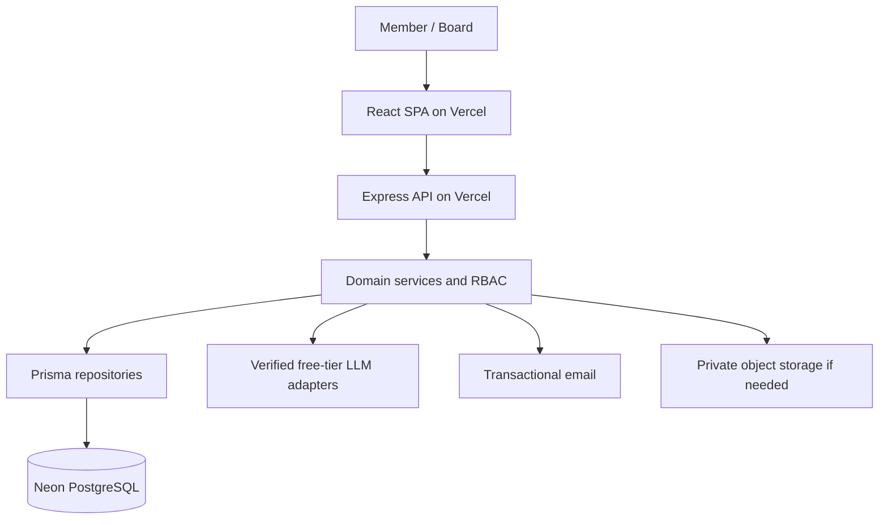
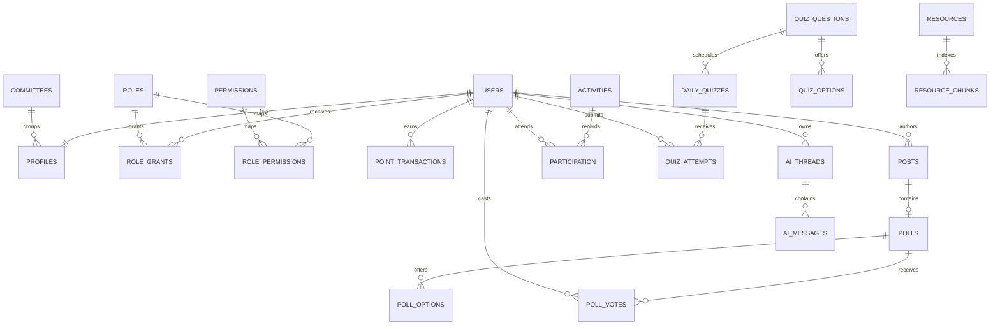
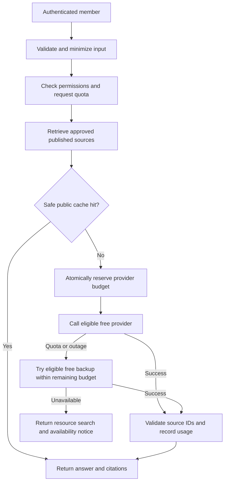

# MUN Club — Master Technical Architecture
Version 5.0 — Free-first, PWA, OneSignal and 140-user readiness edition | Proposed implementation baseline | 25 November 2026

## 1. Scope and decisions
Sources: MUN Club App Project Plan, pp. 1–7; MUN Club App Presentation, slides 1–15. The presentation is a concept, not evidence of implemented software. Preserve Home, Feed, Fantasy, AI Assistant, Profile as the five primary member destinations. Daily Quiz and Resources are secondary routes. Board dashboard is permission-gated. No calendar module. Replace the original suggested MongoDB with Neon PostgreSQL per the project owner; build a responsive web app rather than native mobile. Basic badges, attendance history and curated resources are included as proposed baseline; advanced seasons, comments, QR attendance, streaks, dictionary and feedback are later scope. PWA and OneSignal notifications are mandatory for this release. Board must approve final scoring, branding, membership policy and permissions before launch.

## 2. Architecture and dependencies
TypeScript strict mode throughout; React/Vite, React Router, TanStack Query, Tailwind and accessible shadcn/ui components. Node.js LTS + Express, Prisma ORM, PostgreSQL on Neon, Zod runtime contracts, Vitest, Supertest and Playwright. Pin mutually compatible versions and commit lockfile. Modular monolith; no microservices, Redis or mandatory background worker. Browser calls same-origin /api/v1; Express handles authentication, authorization, validation and domain services; repositories own persistence. Shared package contains DTOs and schemas, never secrets or database clients. External AI, OneSignal, email and optional object storage adapters are server-only. Dependency direction: route -> middleware -> controller -> service -> repository -> database; cross-module writes through services, sharing transaction context. Controllers translate HTTP, services enforce business rules, repositories query data. No direct frontend DB access.



## 3. Repository structure
```text
mun-club/
  package.json                 # npm workspaces, root scripts
  package-lock.json
  tsconfig.base.json
  eslint.config.js
  .gitignore
  .env.example
  README.md
  vercel.json                  # SPA fallback excluding /api
  api/index.ts                 # Vercel entry exporting Express app
  apps/
    web/
      package.json
      vite.config.ts
      index.html
      src/
        main.tsx
        app/{router,providers,query-client}.tsx
        layouts/{MemberLayout,AdminLayout,AuthLayout}.tsx
        components/{ui,shared,navigation}/
        features/
          auth/ profile/ home/ feed/ polls/ fantasy/
          quiz/ resources/ assistant/ admin/
        lib/{api,errors,format,permissions}.ts
        styles/globals.css
      tests/
    server/
      package.json
      src/
        app.ts                 # Express app, no listen()
        local.ts               # local-only listen()
        config/{env,logger}.ts
        db/{client,transaction}.ts
        middleware/{auth,authorize,validate,csrf,rate-limit,error}.ts
        modules/
          auth/ members/ committees/ access/ home/
          feed/ polls/ activities/ points/ leaderboard/
          badges/ quiz/ resources/ assistant/ audit/ admin/
        integrations/{llm,email,storage}/
        routes.ts
      prisma/
        schema.prisma
        migrations/
        seed.ts
      tests/{unit,integration}/
  packages/contracts/src/{auth,members,feed,points,quiz,common}.ts
  tests/e2e/
  docs/{architecture,erd,api,security,runbook,adr}/
  .github/workflows/{ci,release}.yml
```
Each backend module contains `*.routes.ts`, `*.controller.ts`, `*.service.ts`, `*.repository.ts`, `*.schema.ts`, `*.types.ts` and tests where appropriate. Each frontend feature contains pages, components, hooks, api.ts and tests. Avoid empty boilerplate; introduce files only when needed. Root scripts: dev, build, lint, typecheck, test, test:e2e, db:generate, db:migrate:dev, db:migrate:deploy, db:seed. Root API entry imports the server app; verify bundling and Prisma generation in Vercel preview before production. Configure Vite output and Vercel build/output settings explicitly; API catch-all routing must preserve original path and HTTP method. Local Vite proxy forwards /api to Express. Never route API errors to index.html.

## 4. Pages and UX
| Route | Behavior |
|---|---|
| /login, /register, /forgot-password, /reset-password | Authentication, pending approval and recovery |
| / | Welcome, own points/rank/level, pinned announcement, upcoming activities, shortcuts, weekly top three |
| /feed, /feed/:id | Filters, pinned official posts, polls, winners, challenges; no member publishing |
| /fantasy | Weekly/monthly/global leaderboard, own rank, points history, badges |
| /assistant | MUN-focused chat, shortcuts, citations, resource library link |
| /profile, /profile/edit | Photo, committee, position, role, achievements, attendance; only safe fields editable |
| /quiz | Today's question, submit once, feedback and awarded points |
| /resources, /resources/:id | Search, categories, approved guides/templates/UN links |
| /admin | Statistics, recent transactions and quick actions |
| /admin/members, /admin/roles | Member approval, deactivation, scoped grants |
| /admin/feed, /admin/polls | Draft/publish/pin, options, results |
| /admin/points, /admin/activities, /admin/badges | Rules, awards, corrections, attendance, achievements |
| /admin/quiz, /admin/resources | Question bank, daily schedule, approved content |
| /admin/audit, /admin/settings | Authorized audit search and configuration |

Mobile-first bottom navigation with five items; desktop sidebar or top navigation. Admin sidebar separate within same SPA. Use consistent typography, spacing, accessible contrast, keyboard focus, reduced motion, responsive tables, loading/empty/error states, confirmation for destructive actions. No fake data in production; sample names from slides are demo only. Profile contact information private; leaderboard exposes approved display name and score only. No calendar page. Upcoming activities are a compact list.

## 5. Relational database blueprint
Notation: UUID primary keys unless stated; FK references listed table; timestamps UTC timestamptz; created_at/updated_at on mutable records. All required fields NOT NULL unless explicitly optional. Use migrations for CHECK constraints and composite foreign keys not expressed by ORM. Restrict deletion of audit/ledger references; deactivate users instead of hard deleting; implement approved privacy erasure/anonymization process. All IDs generated server-side.

| Table | Key columns and constraints |
|---|---|
| users | email normalized UNIQUE, password_hash, status PENDING/ACTIVE/DISABLED, email_verified_at nullable, auth_version integer |
| profiles | user_id PK FK users, display_name, avatar_key nullable, committee_id nullable FK committees, position, bio nullable |
| committees | name UNIQUE, active boolean |
| roles | code UNIQUE (PRESIDENT, VP, HEAD, ADMIN, MEMBER), name |
| permissions | code UNIQUE, description |
| role_permissions | role_id FK, permission_id FK, composite PK |
| role_grants | user_id, role_id, scope_key NOT NULL (GLOBAL or committee UUID), committee_id nullable FK, granted_by FK users, UNIQUE(user_id,role_id,scope_key), scope consistency CHECK |
| sessions | token_hash UNIQUE, user_id FK, expires_at, revoked_at nullable, auth_version |
| auth_tokens | token_hash UNIQUE, user_id FK, purpose, expires_at, consumed_at nullable |
| posts | author_id FK, committee_id nullable FK, type ANNOUNCEMENT/POLL/WINNERS/UPDATE/CHALLENGE, title, body, status DRAFT/PUBLISHED/ARCHIVED, pinned boolean, published_at nullable |
| polls | post_id UNIQUE FK posts, opens_at, closes_at, result_policy, status |
| poll_options | poll_id FK, label, sort_order, UNIQUE(poll_id,id) |
| poll_votes | poll_id FK, option_id, user_id FK, UNIQUE(poll_id,user_id), composite FK(poll_id,option_id) |
| activities | title, type EVENT/TRAINING/COMPETITION/CHALLENGE/ORGANIZING, committee_id nullable, starts_at nullable, status, post_id nullable FK |
| participation | activity_id FK, user_id FK, status, recorded_by FK, UNIQUE(activity_id,user_id) |
| point_rules | code UNIQUE, amount integer, enabled, version, updated_by FK |
| point_transactions | user_id FK, amount signed integer nonzero, reason, rule_code nullable, rule_version nullable, source_type, source_id, idempotency_key UNIQUE, approved_by nullable FK, actor_type HUMAN/SYSTEM, reversal_of nullable UNIQUE FK self, effective_at, created_at |
| badges | code UNIQUE, title, description, icon_key, active |
| member_badges | user_id FK, badge_id FK, awarded_by FK, awarded_at, UNIQUE(user_id,badge_id) |
| quiz_questions | prompt, explanation, source_url, status, author_id FK |
| quiz_options | question_id FK, label, is_correct boolean, sort_order, UNIQUE(question_id,id); enforce exactly one correct at publish |
| daily_quizzes | local_date DATE UNIQUE, question_id FK, reward_points CHECK 0 or 2..5, published_at; immutable after first attempt |
| quiz_attempts | daily_quiz_id FK, user_id FK, option_id FK, correct boolean, awarded_points integer, submitted_at, UNIQUE(daily_quiz_id,user_id); validate option belongs to scheduled question |
| resources | title, category, description, source_url nullable, object_key nullable, status, approved_by nullable FK, version, reviewed_at nullable |
| resource_chunks | resource_id FK, version, ordinal, content, source_locator, search_vector tsvector, UNIQUE(resource_id,version,ordinal); optional embedding vector later, only with verified free capacity |
| ai_threads | user_id FK, title, created_at |
| ai_messages | thread_id FK, role USER/ASSISTANT, content, citations JSONB, created_at |
| ai_usage | user_id FK, local_date, request_count, token_count, UNIQUE(user_id,local_date) |
| audit_events | actor_id nullable FK, action, target_type, target_id nullable, scope_key, redacted_metadata JSONB, request_id, created_at |
| club_settings | key PK, value JSONB, updated_by FK, updated_at |
| rate_limits | bucket_key PK, count, window_end |

Indexes: sessions(user_id,expires_at), posts(status,published_at DESC), posts(committee_id,status), point_transactions(user_id,effective_at), point_transactions(effective_at,user_id), participation(user_id), quiz_attempts(user_id,submitted_at), resources(status,category), GIN resource_chunks(search_vector), audit_events(created_at), audit_events(actor_id,created_at). Use EXPLAIN on leaderboard/feed queries before adding caches. Use UTC storage and Africa/Cairo for club date boundaries; calculate start/end in application with timezone-aware library, including DST.



## 6. Authorization and authentication
Default deny; check active account and current grants on every protected request, including object-level scope. President global management; VP configurable subset; Head assigned committee only; Admin explicit grants; Member own profile, published content, eligible polls and quizzes, own chat/history. Permission codes: members.read/manage, roles.manage, feed.publish/manage, polls.manage, points.award/reverse/rules, activities.manage, badges.award, quiz.manage, resources.manage, stats.read, audit.read, settings.manage. Global posts and grants require global permission; committee grants cannot escalate to global. Prevent last active President removal using transaction lock; forbid self-escalation; audit all role changes. Do not infer privileges from position text or client UI. Registration pending approval by default (board decision); verify email, approve membership, then activate. Password hashing with Argon2id or vetted scrypt implementation, unique salts. Random opaque session tokens stored hashed in DB; Secure HttpOnly SameSite=Lax cookie in production; rotate on login, revoke on logout/reset/deactivation; check auth_version. CSRF token plus origin checks for mutations, same-origin requests, rate limits persisted across serverless instances. Reset tokens single-use, hashed, short expiry; generic login/reset responses. MFA for privileged accounts recommended before launch; if deferred record board risk acceptance. Never seed production passwords or expose keys in VITE_ variables.

## 7. Domain workflows and invariants
Points: append-only ledger, no editable balances. Board-approved defaults: event +10, training +5, Best Delegate +30, competition +15, challenge +10, organizing +20, correct quiz +2–5. Rules versioned; past awards never recomputed. Award service validates scope, member eligibility, rule, reason and unique event key; insert award and audit in one transaction. Manual adjustment requires reason and client idempotency key; duplicate retry returns original result, conflicting payload returns 409. Corrections use compensating transaction linked to original; unique reversal prevents repeated reversal. Automated quiz awards use SYSTEM actor and approved quiz rule, never pretend a human approved the individual attempt. Decide with board whether negative balances are allowed; proposed allow signed totals for transparent corrections. Leaderboards SUM ledger amounts by effective_at, global/week/month; week starts Monday Cairo time, deterministic tie ordering by user ID with shared rank via DENSE_RANK. Exclude disabled users from public rankings but preserve history. Level thresholds configurable; basic badges manually awarded. Winners posts snapshot selected results, not a new points award.

Polls: authorized admin creates draft post and options, publishes atomically; at least two options, close > open; immutable options after voting. One vote per member, no change by default. Check open interval and membership in transaction; enforce unique vote and composite option FK. Results policy proposed after vote or close; return aggregate counts only, never voter identities to members. Challenges are activity-linked posts; board records completion; no self-award.

Quiz: admin prepares question bank and schedules one question per Cairo date. No cron required: query today's scheduled record on request. If absent show no quiz today. GET never returns correctness/explanation before attempt. Submit validates question/date/option; insert attempt, award and audit atomically; duplicate retry returns original outcome. Question/options/reward immutable once published or used; use new version for corrections. Immediate feedback includes source and explanation. Attendance recorded by authorized staff; no QR in MVP. Participation and points can be recorded together in a transaction, with separate eligibility checks.

Resources: curated official UN links and board-approved text/templates; validate file types/size, private storage and signed download URLs if uploads enabled; do not store large binaries in Neon or Vercel local filesystem. If no storage provider selected, launch link/text library and explicitly defer file upload until configured. AI retrieval uses published resource chunks only, full-text search first; optional pgvector after measured need. Cite actual retrieved source URLs/locators, distinguish fact/analysis, state uncertainty, never invent citations or claim live news without current evidence. Treat retrieved text as untrusted; no tool execution or access to member data. AI is educational, neutral and not a political persuasion tool. Limit input/output, per-user and global budget, timeouts, retries only where safe. Provider outage returns graceful error; all other modules remain functional. Private chat history with deletion/retention policy, no unnecessary personal information sent to provider.

## 8. REST API contract
Prefix /api/v1. JSON success `{data, meta?}`; errors `{error:{code,message,fieldErrors?,requestId}}`. HTTP 400 validation, 401 unauthenticated, 403 forbidden, 404 missing/inaccessible object, 409 conflict, 429 rate limit, 503 dependency unavailable. Cursor pagination with bounded limit (default 20, max 100), stable sort and opaque cursor. ISO timestamps. Validate body, params, query; reject unexpected privileged fields. Document exact DTOs in OpenAPI and share Zod schemas. Never serialize password hashes, tokens, quiz answer keys or internal audit metadata.

| Method and path | Contract / authorization |
|---|---|
| POST /auth/register, /login, /logout | Registration, session creation/revocation |
| POST /auth/forgot-password, /reset-password, /verify-email | One-time tokens, rate limited |
| GET /auth/me, /home | Current user, permissions; aggregated dashboard |
| GET/PATCH /profile/me | Own profile; patch displayName,bio,avatar only |
| GET /feed, /feed/:id | Published eligible posts |
| POST /polls/:id/votes | optionId; eligible active member |
| GET /polls/:id/results | Aggregate subject to result policy |
| GET /leaderboard?period=weekly | period weekly/monthly/global, cursor; own rank |
| GET /points/me, /badges/me, /participation/me | Own history |
| GET /quiz/today | Question/options without key, or submitted outcome |
| POST /quiz/:id/attempt | optionId; atomic scoring |
| GET /resources, /resources/:id | Published resources only |
| GET/POST /assistant/threads | Own threads |
| GET/POST /assistant/threads/:id/messages | Own thread; message text, citations, limits |
| DELETE /assistant/threads/:id | Own thread deletion |
| GET/POST /admin/members; PATCH /admin/members/:id | Scoped membership management |
| POST/DELETE /admin/members/:id/grants | Explicit role grant/revoke, no escalation |
| GET/PATCH /admin/roles/:id | Permission management, global only |
| POST/PATCH /admin/posts[/:id] | Draft/edit; feed permission |
| POST /admin/posts/:id/publish, /pin, /archive | Scoped transitions |
| POST/PATCH /admin/polls[/:id] | Draft options, open/close policy |
| POST /admin/points/awards | userId, amount or ruleCode, reason, sourceId, idempotencyKey |
| POST /admin/points/:id/reverse | reason, idempotencyKey |
| GET/PATCH /admin/point-rules[/:id] | Board-controlled rules |
| POST/PATCH /admin/activities[/:id] | Activity management |
| POST /admin/activities/:id/participation | userId,status; scoped staff |
| POST /admin/badges/:id/awards | userId, reason |
| POST/PATCH /admin/quiz/questions[/:id] | Question bank |
| POST /admin/quiz/schedule | localDate,questionId,rewardPoints |
| POST/PATCH /admin/resources[/:id] | Curate, approve, archive, index |
| GET /admin/stats, /admin/audit | Scoped aggregates / privileged audit |
| GET/PATCH /admin/settings | Approved configuration |
| GET /health/live, /health/ready | Liveness; bounded DB check, no secrets |

Example quiz submission: `{ "optionId": "uuid" }` -> `{ "data": { "correct": true, "awardedPoints": 3, "explanation": "...", "sourceUrl": "https://www.un.org/" } }`. Never trust client-supplied user ID, correctness, score or role for member operations. Admin list endpoints use same pagination and scope filters; add read endpoints for every admin editor before UI implementation.

## 9. Deployment and operations
One private GitHub repository, protected main, feature branches and PR review. Vercel project connected to GitHub; same-origin static frontend and Express function. Export Express app, no persistent listen in serverless entry; no in-memory sessions, jobs or durable files. Use Neon pooled connection for runtime, direct connection for migrations; configure Prisma version-specific adapter and connection limits; reuse client per warm instance. Separate Neon branches/databases and secrets for local, preview, production; never use production data in preview. CI: npm ci, generate Prisma, lint, typecheck, unit/integration tests against isolated PostgreSQL, build, Playwright smoke. Migration release gate: reviewed additive migrations, backup/restore checkpoint, run migrate deploy once via protected release job before promoting compatible application. Never run destructive migrations or seed production on every build. Verify Vercel routing, function limits, current plan eligibility and Neon quotas before launch; free plans may sleep, cold start and impose limits. No dependence on frequent cron. Use structured logs with request ID, redact secrets, track latency/error rates and AI spend; alert on repeated failures. Backups per Neon plan plus encrypted export where approved; test restore to isolated DB. Roll back app via previous deployment only if schema compatible; forward-fix otherwise.

Environment variables: DATABASE_URL, DIRECT_DATABASE_URL, APP_ORIGIN, SESSION_SECRET (if signing/CSRF needs it), EMAIL_PROVIDER_KEY, EMAIL_FROM, AI_ENABLED, AI_PRIMARY_PROVIDER, GEMINI_API_KEY, GEMINI_MODEL, GROQ_API_KEY, GROQ_MODEL, AI_DAILY_LIMIT, AI_GLOBAL_DAILY_LIMIT, AI_MONTHLY_LIMIT, STORAGE credentials if enabled. Validate at startup; optional integrations fail closed with feature unavailable state. .env.example placeholders only. Never commit .env, dumps, tokens or member exports. Set Vercel secrets by environment. Initial President provisioned via controlled one-time command and password reset; no public bootstrap endpoint.

## 10. Quality, security and acceptance gates
Unit tests: permission scope, scoring, reversals, rank ties, Cairo date boundaries, quiz feedback, poll policy, validation. Integration tests on real PostgreSQL: concurrent duplicate votes/quiz attempts/awards, cross-committee denial, rollback on audit failure, session revocation, last-President protection, migration from empty and prior schema. E2E: register/approve/login, profile edit, board publish/pin, vote, award/reverse, leaderboard, quiz, resources, AI citations and outage, logout, mobile navigation and keyboard accessibility. Test unauthorized direct API calls, IDOR, CSRF, XSS (sanitize rich text), injection, brute-force and file access. Use dependency scanning and secret scanning; no critical unresolved vulnerabilities at release. Proposed performance targets: p95 warm non-AI reads <500ms under 140 concurrent representative users, mobile Lighthouse accessibility >=90; measure rather than promise, document cold starts separately. AI latency measured separately. Production smoke with test account; no real member data in tests. Verify backup restore, rollback, support contact, privacy notice, retention and admin handover. No feature marked done based on mock UI alone.

## 11. Implementation sequence and ownership
1. Planning: approve scope, role matrix, point policy, Figma, ERD and API contracts; create repository and ADRs.
2. Core: foundation, migrations, authentication, member profiles, committees, authorization, feed/polls, admin shell and audit.
3. Engagement: activities/attendance, ledger, leaderboard, badges, quiz, home aggregation; concurrency tests.
4. Learning: resource library, curated ingestion, AI adapter, citations, quotas and evaluation.
5. Launch: full integration, responsive QA, accessibility/security, migration rehearsal, deployment, handover.
IT team workstreams from plan: UI/UX; Auth/Profile; Fantasy/Points; Feed/Community; AI/Resources; Admin; Backend/DB; Testing/Deployment. Head of IT owns contracts, reviews, integration and blockers, not every implementation. Each PR includes tests, migration impact, screenshots for UI, and updated docs. Definition of done: real DB persistence, server-side permissions, validated API, complete loading/error/empty states, tests, documentation and review.

## 12. Build instructions for coding agent
Use this specification as baseline, not permission to invent scope. First inspect repository and existing code, create implementation plan and ADRs, then implement in phases. Generate actual Prisma schema and SQL migrations from section 5, OpenAPI from section 8, and typed shared contracts before wiring UI. Resolve outstanding board decisions explicitly; use documented defaults in development only. Do not replace stack, add a calendar, create separate native app or deploy without authorized credentials and release approval. Do not use mock endpoints in production. Run tests after each phase, report commands/results and remaining blockers. Deliver README, environment example, architecture/ERD, API docs, migration history, seed for local only, CI, deployment and handover runbook. Final report maps each source feature to implementation files, API, tests and status (verified/partial/not implemented). Do not claim production readiness until all release gates pass.

## 13. Open decisions and source traceability
Board: final scoring and levels, membership verification/approval, VP and Head scope, poll result visibility, retention, leaderboard display consent, branding and AI usage quotas and privacy policy (paid AI is prohibited). Technical: exact package versions, email/LLM/storage providers, Vercel plan, expected load and backup retention. Source mapping: Plan pp.2–3 and slides 4–12 -> sections 4–8; Plan p.4 and slide 13 -> deferred scope; Plan pp.4–5 and slide 14 -> section 11; Plan p.6 -> stack (Neon replaces MongoDB); Plan p.7 -> MVP and release gates. This is a design specification, not an implemented or tested website. Schema and API are proposed contracts, not executable migrations or complete OpenAPI yet.


## 14. Mandatory free-first operating architecture (normative)
This section supersedes any earlier language implying paid AI or mandatory paid dependencies. Target recurring cost: $0, conditional on eligibility, current quotas and actual traffic. Never enable billing, buy credits, upgrade plans or silently fall back to a paid model. If a free service is unavailable, degrade gracefully; report the limitation. Free-tier availability and current terms have not been independently verified for this specification. Before launch, record official plan terms, geographic and age eligibility, organization-use eligibility, data processing terms, quota units, reset times, storage and function limits in docs/operations/free-tier-register.md. Review before each release. Do not assume Vercel Hobby is eligible for this club; verify permitted noncommercial organizational use and use an approved eligible deployment plan or stop deployment for owner decision. No paid fallback.

| Component | Preferred baseline | Degradation path |
|---|---|---|
| GitHub | Free private repository | Local development; no paid CI |
| Vercel | Hobby if eligible | Stop release if ineligible; owner decision |
| Neon | Free PostgreSQL | Reduce queries/storage; maintenance mode if exhausted |
| AI generation | Gemini free tier if eligible | Groq free tier if independently eligible; then resource-only search |
| Retrieval | PostgreSQL full-text search | Curated links and keyword search |
| Embeddings | Optional verified free model + pgvector | Disable embeddings; no paid vector service |
| Email | Verified free transactional provider | Board-managed invitation/recovery workflow with identity verification |
| Files | Curated links/text initially | Optional verified free private object storage; no uploads until configured |
| Domain | Vercel subdomain | No purchased domain required |

### 14.1 AI implementation layout
```text
apps/server/src/modules/assistant/
  assistant.routes.ts
  assistant.controller.ts
  assistant.service.ts
  assistant.repository.ts
  assistant.schema.ts
  retrieval.service.ts
  citations.service.ts
  quota.service.ts
  cache.service.ts
  policy.service.ts
  assistant.test.ts
apps/server/src/integrations/llm/
  provider.ts
  gemini.adapter.ts
  groq.adapter.ts
  provider-registry.ts
  provider-errors.ts
apps/web/src/features/assistant/
  pages/AssistantPage.tsx
  components/{ChatInput,MessageList,SourceList,UsageNotice}.tsx
  hooks/useAssistant.ts
  api.ts
packages/contracts/src/assistant.ts
```
Provider interface accepts bounded messages and approved source excerpts, returns text, usage when available, provider/model ID and normalized error. Model IDs are configuration, not hard-coded assumptions. Only allow explicitly verified free models. No browser API keys, autonomous browsing, tools, code execution or member-data retrieval. Disable AI by default until eligibility, privacy and quota checks pass. Never send personal profiles, email addresses, attendance, points, private club records or secrets to providers. Warn users not to enter sensitive data. Verify provider terms for student/minor users and free-tier data use; if unsuitable, disable external AI for affected users and retain resource search.

### 14.2 Request lifecycle

Retrieval: normalize query, use PostgreSQL GIN full-text index, select up to 5 relevant published chunks with source title, URL, version and locator. Use official UN sources and approved club guides; distinguish club-specific procedure from UN procedure. Treat retrieved content as untrusted data. Require citations to retrieved IDs only; reject unknown IDs, show uncertainty when evidence is weak, label analysis and drafting suggestions. No claim of live information unless verified current evidence exists. Optional vector search must have measured benefit and free capacity; track embedding model/dimension/version and rebuild safely on changes.

### 14.3 Database extensions
Add to section 5 through reviewed migrations:
| Table | Fields and constraints |
|---|---|
| ai_provider_budgets | provider, model, window_type, window_start, reserved_requests, reserved_tokens, used_requests, used_tokens; composite unique provider/model/window; nonnegative counters |
| ai_requests | id UUID, user_id FK, idempotency_key, request_hash, provider/model nullable, status RESERVED/SUCCEEDED/FAILED/UNKNOWN, reserved_tokens, actual_tokens nullable, created_at, completed_at nullable; UNIQUE(user_id,idempotency_key) |
| ai_cache | cache_key unique, answer, citations JSONB, corpus_version, policy_version, model, expires_at; public generic queries only |
| ai_settings | singleton key, enabled, primary_provider, fallback_provider nullable, per_user_daily_limit, global_daily_limit, global_monthly_limit, max_input_chars, max_output_tokens, updated_at, updated_by FK |
| ai_provider_attempts | request_id FK, attempt_number, provider, model, status, reserved_tokens, actual_tokens nullable, started_at, finished_at nullable; UNIQUE(request_id,attempt_number) |
Index ai_requests(user_id,created_at), ai_provider_attempts(provider,started_at), ai_cache(expires_at). Never store raw prompts in operational logs. Private thread content follows approved retention and deletion rules. Cache only generic public answers with no personal or conversation context; invalidate on resource/policy version change. Do not cache errors. Store quota windows in UTC using provider reset rules; member daily quotas use Africa/Cairo.

### 14.4 Quotas, resilience and API
Initial conservative development defaults (not provider quota claims): 5 requests/member/day, 100 global/day, 1000 global/month, 2000 input characters, 512 output tokens, max 5 retrieved chunks, bounded conversation context. Reduce to actual verified provider limits before launch. Reserve estimated input/output tokens and request counts atomically in PostgreSQL before each provider attempt, including fallback. Lock budget rows in consistent order, commit before network call, reconcile usage afterwards; count unknown outcomes conservatively. Never hold a database transaction across network calls. Concurrent requests cannot exceed configured caps. Deduplicate by user/idempotency key and reject mismatched payloads. Do not retry unknown outcomes automatically. At most one fallback for explicit quota/unavailable errors within verified remaining quota and function time budget. Respect Retry-After; no busy loops. No mandatory cron or background worker; expire cache opportunistically with bounded cleanup. No unbounded chat history or automatic ingestion.

Add API contracts: GET /api/v1/assistant/status (availability, remaining member quota, reset time); POST /api/v1/assistant/threads/:id/messages (bounded message, idempotency key; returns answer, verified citations, usage status); DELETE /api/v1/assistant/threads/:id (own thread only); GET /api/v1/admin/ai/usage (aggregated counts, failures, cache hits, no raw messages); PATCH /api/v1/admin/ai/settings (settings.manage permission, validated allowlist and caps, audit event). Reconcile these routes with section 8 rather than creating duplicate handlers. Return 429 for exhausted member/global quota, 503 for unavailable provider, and include safe resource links. UI shows AI unavailable, quota reset, source links and retry guidance; Home, Feed, Fantasy, Profile, Quiz and Admin remain operational.

### 14.5 Cost controls and release tests
Maintain a quota register with official URLs, verification date, plan owner, eligibility, limits and response when exhausted. Monitor Neon storage, compute and connections; Vercel requests/function duration; GitHub Actions usage; AI provider requests/tokens. Use bounded pagination, indexed queries, compressed static assets, lazy-loaded AI/admin pages, no polling loops, no unnecessary keep-alive requests. Cold starts and expected database sleep are not automatically failures. Do not schedule frequent cron jobs to prevent sleeping. Admin usage dashboard reports measured usage separately from estimates. Alert at configurable thresholds, stop AI before verified limits are reached. Keep external service credentials separate per environment; preview AI disabled by default. Use deterministic fake provider only in tests, not production.

Acceptance tests: concurrent quota reservations, duplicate requests, cache isolation, resource version invalidation, citation fabrication rejection, private-data exclusion, provider timeout, explicit quota exhaustion, fallback budget enforcement, disabled AI, missing keys, unauthorized admin settings, thread ownership and deletion, core app functioning without AI. Test production configuration with an eligible free provider using minimal requests; record evidence without exposing secrets. No claim of zero cost or production readiness without verified plan eligibility and release gates.

## 15. Implementation handoff and traceability
Keep this file at repository root. Create docs/adr/ for architectural decisions, docs/api/openapi.yaml, docs/database/erd.md, docs/security/threat-model.md, docs/operations/free-tier-register.md, docs/operations/runbook.md and docs/implementation/traceability.md. Map each source requirement to route, module, database entity, permission, test and status. The PDF pages 2–3 and presentation slides 4–12 define core features; PDF pages 4–7 and slides 13–14 define priorities and delivery. Free AI is an explicit owner override, not a claim from those source files. Do not expand deferred scope without approval.

Implementation agent: read the entire specification and source documents; inspect the repository; report conflicts; implement foundation, core, engagement, learning and release phases in order. Generate executable schema and migrations, typed contracts, UI and real APIs, tests and operational documentation. Keep all changes reviewable in GitHub PRs. Never commit secrets, enable paid services, or deploy without authorization. Report actual test commands and outcomes, remaining decisions and blockers. This document is a proposed design, not executable software or proof of a deployed website.


## 16. Mandatory brand identity and design system
The supplied XIX LEGACY JPEG is the authoritative visual reference. Its two most frequent decoded RGB values are midnight navy RGB(2,6,33) / #020621 and legacy gold RGB(188,147,67) / #BC9343. JPEG compression produces nearby shades; use these exact canonical tokens, not a generic blue or yellow. Preserve the original emblem, lettering, proportions and XIX. Place the supplied asset at apps/web/public/brand/mun-logo.jpg; retain the original separately. Do not redraw or recolor it. Confirm club permission before public release.

### Global design tokens
```css
:root {
  color-scheme: dark;
  --brand-navy: #020621;
  --brand-gold: #BC9343;
  --background: var(--brand-navy);
  --surface: #0B102D;
  --surface-raised: #141A38;
  --foreground: #F5F3ED;
  --muted-foreground: #B9BED0;
  --border: #343A55;
  --primary: var(--brand-gold);
  --primary-foreground: var(--brand-navy);
  --focus-ring: var(--brand-gold);
  --success: #86D3A2;
  --warning: #EBC879;
  --danger: #FF9B9B;
}
```
Only the two brand tokens are extracted from the logo; supporting neutrals and semantic colors are proposed accessibility choices. Use centralized CSS tokens in apps/web/src/styles/tokens.css and map Tailwind/shadcn tokens to them. No arbitrary brand colors in individual modules. Use gold sparingly for actions, selected states, ranking accents and focus. Use dark text on gold buttons. Use readable light text for long content. Verify WCAG AA contrast for actual combinations, keyboard focus, non-color status labels and reduced motion.

### Layout and typography
Use a premium diplomatic visual language, restrained borders and spacing, no excessive gradients or animation. Proposed fonts: Cinzel for display headings and Inter for UI/body; use licensed locally hosted assets or system fallbacks. Mobile uses the five existing navigation destinations; desktop uses a responsive sidebar or header. Preserve secondary quiz and resources routes. Admin uses the same tokens and a separate permission-gated layout. Use the logo on login, navigation and appropriate brand headers; avoid cropping and stretching. Use descriptive alt text, explicit image dimensions and optimized derivatives without changing visual identity. No mandatory paid fonts, icon sets or design services.

### Implementation and acceptance
Create reusable Button, Card, Badge, Input, Dialog, Navigation, PageHeader, EmptyState, ErrorState, Skeleton and DataTable components. Apply tokens to Home, Feed, Fantasy, AI, Profile, Quiz, Resources, authentication and all admin screens. Test 360, 768 and 1440px layouts, keyboard navigation, contrast, reduced motion, loading/error/empty states and overflow. Verify exact brand tokens in source and rendered UI. Use the actual supplied logo, not a generated substitute. Preserve all earlier functional, security, database, deployment and free-AI requirements. This update is a specification only; no implementation or visual acceptance tests have been performed.


## 17. Mandatory mobile-first UI reference specification (V4)

### 17.1 Source hierarchy
The supplied MUN_Club_App_Presentation.pptx is the screen-layout reference (slides 4–11); MUN_Club_App_Project_Plan.pdf defines feature scope. The supplied XIX LEGACY JPEG defines branding. Preserve screen hierarchy and content order rather than copying prototype colors or sample data. The original image's dominant RGB values are (2,6,33) and (188,147,67), corresponding to #020621 and #BC9343. The presentation is a concept, not a pixel-perfect production design. This section supersedes conflicting layout guidance in sections 4 and 16; all other V3 requirements remain in force.

### 17.2 Member application shell
- Mobile-first responsive SPA, no native app required. At widths below 768 CSS px use a fixed bottom navigation on all authenticated member screens, including secondary routes. At 768px and above use a responsive desktop sidebar with the same destinations; never show both navigation systems simultaneously.
- Exact bottom navigation order: Home (/home), Feed (/feed), Fantasy (/fantasy), AI (/ai), Profile (/profile). Map these to existing route contracts; if the existing Home route is `/`, use a redirect rather than duplicate screens. Use Lucide House, Newspaper, Trophy, Sparkles, UserRound icons with visible text labels. Active icon and label gold, inactive muted neutral; use aria-current=page. Never add Quiz, Resources or Admin as sixth tabs.
- Use a single MemberLayout with BrandHeader, main outlet and BottomNavigation. Header includes actual logo, screen title where appropriate and a back action on secondary pages. Include a real notification inbox control when implemented; no fake controls.
- Fixed bottom bar spans available width with 12px side inset, rounded 18px corners, navy surface and subtle border; five equal columns, minimum 44x44px targets. Reserve its full measured height plus safe-area inset in scrollable content. Use env(safe-area-inset-bottom, 0px), viewport-fit=cover, and dynamic viewport units with fallback. No horizontal scroll or covered final controls. Dialogs sit above navigation; AI keyboard/composer must remain visible without overlap (hide bar temporarily while keyboard is open if necessary, restore on blur).
- React Router links, not local tab-only state. Support refresh, deep links, browser back/forward and route-specific scroll restoration. Quiz inherits Home active state; Resources inherits AI active state; Profile edit inherits Profile. Use permission-gated Admin link in Profile; separate AdminLayout with explicit return to member portal.
- Mobile content padding 16px, card gaps 12–16px, consistent 12–16px card radius. Use existing brand tokens; gold is accent, not large body text on light surfaces. Body text and controls must pass WCAG AA contrast. Desktop content max width 1200px, adapt cards into columns without changing semantic order. No mandatory paid UI libraries.

### 17.3 Screen-by-screen implementation contract
| Reference | Screen | Required visual hierarchy and behavior |
|---|---|---|
| Slide 4 | Home | Personalized greeting; three compact points/level/rank cards; pinned announcement; upcoming activity list (not calendar); Fantasy/AI/Daily Quiz shortcuts; weekly top-three preview. All values from authenticated dashboard API. |
| Slide 5 | Profile | Avatar, name, committee and position, role label, edit action; points/level/rank; badge grid; attendance history. Only approved editable fields; role and points read-only. |
| Slide 6 | Fantasy | Weekly/Monthly/Global segmented selector; top-three podium (2,1,3 visual order, accessible rank order); ranked list including current user; points history with signed amounts and reasons. Handle ties and fewer than three members. |
| Slide 7 | Feed | All/Announcements/Polls/Winners filters; pinned board post; poll card with options and results; winner card; challenge card. Respect publication permissions and poll result visibility; no comments in MVP. |
| Slide 8 | AI Assistant | Chat transcript with user/assistant messages, source links, quick actions (term, country, speech, rule, resolution), input and send action above bottom navigation. Resources link in header or quick actions. Show quota and outage states without blocking other pages. |
| Slide 9 | Daily Quiz | Today label, one question, selectable answers, submit action, then correct/incorrect feedback, explanation and awarded points. Never expose correct answer before submission. Show completed and unavailable states. |
| Slide 10 | Resources | Search input; All/Guides/Templates/UN links filters; compact resource rows with title/type; authorized detail/download. Include research and club materials via categories. |
| Slide 11 | Admin | Separate responsive dashboard; Members, Feed & Polls, Points, Daily Quiz, Resources, Roles, Statistics; summary cards, recent transactions and quick creation actions. Mobile admin drawer; no member bottom bar inside admin. |

### 17.4 Frontend implementation additions
Place these within the existing workspace and feature folders; reuse equivalent files rather than duplicate components.
```text
apps/web/src/
  layouts/
    MemberLayout.tsx
    AdminLayout.tsx
  components/navigation/
    BottomNavigation.tsx
    DesktopNavigation.tsx
    BrandHeader.tsx
    navigation.config.ts
  components/shared/
    StatCard.tsx
    SectionHeader.tsx
    LoadingState.tsx
    EmptyState.tsx
    ErrorState.tsx
  features/
    home/components/{MemberStats,PinnedAnnouncement,UpcomingActivities,QuickActions,WeeklyTopThree}.tsx
    fantasy/components/{PeriodSelector,LeaderboardPodium,RankingList,PointsHistory}.tsx
    feed/components/{FeedFilters,PostCard,PollCard,WinnerCard,ChallengeCard}.tsx
    profile/components/{ProfileHeader,BadgeGrid,AttendanceHistory}.tsx
    ai/components/{ChatTranscript,ChatComposer,PromptShortcuts,SourceList}.tsx
    quiz/components/{QuestionCard,AnswerOptions,QuizFeedback}.tsx
    resources/components/{ResourceSearch,ResourceFilters,ResourceList}.tsx
  styles/
    tokens.css
    app-shell.css
```
Use shared Zod DTOs and TanStack Query; invalidate dashboard, leaderboard and points history after successful quiz/points operations. Do not add duplicate API endpoints or tables merely for visual components. Loading, empty, error, retry, disabled and unauthorized states are mandatory. Sample names, ranks and posts from the presentation are development fixtures only.

### 17.5 Visual acceptance and release gates
- Capture real Playwright screenshots at 320, 360, 390, 430, 768, 1024 and 1440 CSS px; compare mobile screen hierarchy against slides 4–10 and admin against slide 11. Record deviations and obtain board approval for material changes.
- Verify exactly five member tabs, correct active state, deep links, back navigation, keyboard focus, touch targets, safe-area spacing, landscape and no horizontal overflow. Test long names, empty leaderboards, long announcements, large text, quiz feedback, AI keyboard and slow/offline network states.
- Verify bottom navigation never obscures last list item, quiz submit, chat composer, or profile save. Test on actual Android/iOS browsers before claiming device compatibility.
- Verify original logo and exact brand colors; preserve logo aspect ratio and XIX lettering. Use optimized local image derivatives without redesigning the emblem. No generated replacement logo.
- Keep member and admin functionality connected to real APIs and Neon; no mock production screens. All V3 security, free-first AI, quota, testing and deployment gates remain mandatory. No paid service may be enabled automatically.
- Deliver screenshot comparison report, route map, component inventory and unresolved visual issues in docs/. The specification is not evidence of implemented or tested UI.


## 18. PWA and OneSignal — mandatory release scope
Owner override: notifications and PWA are now core features, not deferred. Preserve the five member tabs and the source screen hierarchy. Use a notification bell/inbox in the header and preferences in Profile, not a sixth tab. OneSignal is the only external push provider. In-app inbox is the durable source of truth; push is best-effort and never a prerequisite for core functionality.

### 18.1 PWA implementation
- Use a version-compatible Vite PWA integration or a minimal custom service worker. Use HTTPS, manifest with stable id, name, short_name, start_url, scope, display standalone, official navy theme/background, 192 and 512 pixel icons and a separate maskable icon preserving the emblem. Provide Apple touch icon. Keep original logo asset unchanged.
- Install affordance only where supported; provide iOS Add to Home Screen guidance. On iOS/iPadOS web push requires supported OS and installed Home Screen app; permission must follow user interaction. Never promise fullscreen or push on every browser.
- Cache only versioned public static shell assets and offline page. Network-only for authenticated APIs, HTML containing personal data, AI, quiz answers, mutations and admin data. No offline writes or queued votes/points. Show offline state and reconnect action. Clear user-specific client state on logout/account switch.
- Coordinate PWA and OneSignal worker scopes explicitly using the SDK version's official documentation. Prefer dedicated OneSignal worker scope (e.g. /push/) if supported; do not register competing workers at the same scope. Serve worker scripts directly with correct MIME, no SPA rewrite, no immutable caching. Test subscription after updates and worker migration. Never replace an existing working worker blindly.
- Prompt for new version when safe; do not reload during form submission, quiz or AI chat. Clean obsolete caches without deleting OneSignal registrations. Verify install, launch, deep links, offline, upgrade and logout on Android, iOS and desktop.

### 18.2 Notification event coverage
Every newly published member-visible item generates a notification for its authorized audience: announcements, general updates, polls, winners, challenges, published activities/training, daily quiz availability, resources and any future publishable content. Also notify affected members of points awards/reversals, badges and relevant membership changes. Drafts, routine edits, private admin actions, internal logs and unpublished content never trigger broadcast. Material updates may notify only via explicit authorized action. Daily quiz publication uses a durable scheduled event; no requirement for exact-time push on a free plan. Notify once per publication/version; do not notify every database write. Preserve privacy, audience scope and member preferences. Group bulk awards and related events where appropriate; avoid duplicate or excessive notifications.

### 18.3 Delivery architecture and schema
Domain transaction writes content/state, audit event and notification event/outbox atomically. Fan-out creates durable inbox records for eligible recipients with unique event/user key; at 140 members bounded bulk inserts are acceptable. Snapshot authorized audience at publication; recheck active membership and permissions before dispatch and when opening links. Push dispatcher claims bounded batches using atomic leases, commits before network I/O, calls OneSignal REST API server-side, records provider message ID and outcome. Never send private payloads or use provider tags as authorization. Use generic lock-screen text for sensitive events. Use stable provider idempotency key if supported, bounded retry/backoff for explicit retryable failures, and reconcile ambiguous outcomes without blind resend. A provider acceptance is not proof of device delivery. Track pending, processing, accepted, failed, unknown, skipped and expired. Failed push never rolls back published content.

| Table | Required fields / constraints |
|---|---|
| notification_events | id UUID, event_type, entity_type, entity_id, version, audience_scope, safe_title, safe_body, internal_route, created_by nullable FK, created_at; unique event_type/entity_type/entity_id/version |
| notifications | id UUID, event_id FK, user_id FK, read_at nullable, created_at; UNIQUE(event_id,user_id); index user_id/read_at/created_at |
| notification_preferences | user_id FK, category, push_enabled; unique user/category |
| push_outbox | id UUID, event_id FK, batch_key unique, status, attempts, next_attempt_at, lease_until, provider_message_id nullable, last_error_code nullable, created_at; index status/next_attempt_at |
| push_subscriptions | user_id FK, provider_subscription_id unique, status, updated_at; only minimal metadata if needed for reconciliation |

Use authenticated OneSignal external identity tied to immutable internal UUID; verify identity with supported server-issued identity verification when available. If secure account binding is not supported by the eligible plan, disable personalized push and retain inbox rather than risk leakage. Initialize SDK lazily after authentication and explicit opt-in; logout/unlink on logout or account switch. Do not expose REST API key. Browser permission denied or unsupported means inbox remains usable. Push links must be validated same-origin routes; authorization checked on every destination. Revoke or suppress deactivated users. Never send AI prompts, private votes or quiz answers in push.

### 18.4 API, configuration and operations
Add GET /api/v1/notifications (cursor pagination), GET /notifications/unread-count, PATCH /notifications/:id/read, POST /notifications/read-all, GET/PATCH /notifications/preferences, authenticated push identity endpoint if required, POST /admin/notifications (authorized manual message with audience preview and confirmation), GET /admin/notifications/delivery and protected dispatch endpoint. Enforce ownership, scope, CSRF, rate limits, audit and idempotency. Add notifications.send and notifications.manage permissions to existing role matrix; President global, other roles explicitly granted and committee-scoped. No direct client calls to provider send API.
Environment: ONESIGNAL_APP_ID (public), ONESIGNAL_REST_API_KEY (server only), optional identity verification secret, PUSH_ENABLED, CRON_SECRET; placeholders only. Separate production and preview; preview push disabled by default. Add server modules/notifications and integrations/onesignal, web features/notifications and pwa, public manifest/icons/worker assets, tests and docs/operations/push-runbook.md. Reuse existing paths where equivalent.
Dispatch immediately after commit within bounded request budget when possible, with durable outbox recovery via protected manual admin retry and eligible scheduled reconciliation. Do not rely on detached promises after Vercel response, persistent processes or frequent cron. If free cron cannot meet desired timing, document delay and show inbox immediately; no paid upgrade without approval. Scheduled quiz notification must use idempotent due-event reconciliation on eligible cron or authenticated activity; exact delivery time is not guaranteed. Verify current OneSignal free plan, web subscriber/message limits, identity features, organization eligibility and data terms; never enable billing. Add OneSignal to free-tier register and usage dashboard. Test duplicate publish, concurrent dispatch, crash after provider acceptance, denied permission, logout/account switch, committee scope, deactivation, retry, provider outage and iOS installation. No production broadcast during testing.

## 19. Performance, responsiveness and 140 concurrent users
### 19.1 Release budgets (targets, not measured results)
- Support 140 simultaneously active authenticated users under representative mixed traffic. Stress to 200 in authorized isolated staging, not production or third-party endpoints. Measure warm and cold separately. No claim of capacity based on total registered accounts.
- Warm non-AI API p95 <=500 ms; p99 <=1500 ms; unexpected error rate <1%; no lost writes, duplicate awards/votes or cross-user leaks. Track expected 429 separately and investigate core API throttling at target load. AI and push delivery latency measured separately; free AI quota exhaustion is expected and must degrade safely.
- Mobile Lighthouse performance >=90 and accessibility >=95 on representative routes, median of three production-build runs under documented mobile throttling. Target LCP <=2.5s, INP <=200ms, CLS <=0.1 at p75 when field data exists; use lab proxies until then. Initial member route JS target <=200 KiB gzip, CSS <=50 KiB gzip, initial transfer <=500 KiB excluding user-requested media; justify deviations with measurements. Avoid heavy animation libraries, large icon imports and unnecessary dependencies.

### 19.2 Responsive and smooth UI
Use viewport width=device-width, initial-scale=1; never disable pinch zoom or set maximum-scale=1. Users should not need zoom to read or navigate. Use fluid CSS grid/flex, min-width:0, max-width:100%, clamp typography, responsive images, wrap long words and labels, and content-driven breakpoints. Avoid fixed desktop widths, global overflow-x:hidden as a substitute for fixing layout, and fixed-height content clipping. Tables use accessible local scrolling or stacked cards. Preserve five-tab bottom bar, safe-area insets and adequate content padding. Use dynamic viewport units and keyboard-aware chat composer. Touch targets at least 44 CSS px where practical. Respect reduced motion; use short transform/opacity transitions and no expensive blur on low-end devices. Maintain keyboard focus, 200% text zoom and browser back behavior. Test 320/360/390/430/768/1024/1440/1920 widths, portrait/landscape, long content, keyboard and actual mobile devices. Assert no document-level horizontal overflow.

### 19.3 Backend and frontend optimization
Route-level lazy loading for AI/admin/resources, lazy images with explicit dimensions, optimized local logo derivatives, subset/self-host fonts where licensed, tree shaking and production bundle analysis. Use TanStack Query dedupe, bounded stale times, targeted invalidation, abort obsolete requests, no global polling loops. Cache public static assets at CDN; private responses no-store or private as appropriate. Paginate feed, history, notifications and admin lists with indexed cursors. Aggregate home stats in bounded queries; avoid N+1 and full-table scans. Inspect EXPLAIN ANALYZE on realistic staging data; add indexes only with evidence. Use Neon pooled runtime connection, bounded per-instance concurrency and reuse Prisma client. Keep transactions short; external AI/push calls outside DB transactions. Protect expensive endpoints with distributed database-backed quotas; isolate AI capacity so core routes remain responsive. No artificial keep-alive to defeat free-tier sleep. Monitor connection saturation, function duration, memory, database compute/storage and quota headroom.

### 19.4 Load test protocol
Use k6 or equivalent free local tool with synthetic accounts and seeded realistic history in isolated staging. Ramp 0→50→140 over 5 minutes, hold 140 for 20 minutes, then ramp down; separate 200-user stress hold 5 minutes and a 60-minute 140-user soak if quotas allow. Representative mix: 35% home/feed, 20% leaderboard, 15% profile/resources, 10% inbox, 10% poll/quiz reads, 10% valid writes including votes/quiz/points with authorized fixtures. Add separate synchronized login and quiz-submit bursts of 140 users; use realistic think time 3–10 seconds for normal journeys. Use unique users and valid CSRF/session flows. Mock external AI and OneSignal only in load environment; test real integrations separately with minimal authorized requests. Test provider outage and Neon cold wake. Stop before free quotas or service terms are breached; if full test cannot run, mark capacity unverified. Record actual RPS, p50/p95/p99, errors, DB connections, query timings, function duration, correctness assertions and resource use. Fix bottlenecks and rerun. Store scripts under tests/load and results under docs/qa/performance.md; no secrets or member data. Verify plan eligibility and quota headroom for expected daily traffic; 140 simultaneous users is a target, not a free-tier guarantee.

## 20. Continue existing implementation — mandatory agent workflow
This version supersedes V4; it does not authorize a rewrite. Start with git status, current branch, recent commits, existing diffs, package manifests, lockfile, source tree, migrations, tests, Vercel config and current UI. Preserve all user changes, working features, data, existing architecture and compatible dependencies. Do not reset, clean, force push, drop tables, overwrite production data or regenerate project scaffolding. Do not change frameworks or rename working routes without documented necessity and approval. Map every requirement in V5 and original references to existing files/tests: VERIFIED, PARTIAL, MISSING, CONFLICT, BLOCKED. Run baseline lint/typecheck/build/tests and record failures before edits. Inspect existing PWA/OneSignal implementations and reuse or repair them; avoid duplicate workers, tables, SDKs or handlers. Reconcile schema through additive reviewed migrations, preserving existing records. Prioritize actual missing core features, then PWA/push, responsive fixes, performance and load tests. Make small reviewable changes; test after each batch and update docs/implementation/progress.md and traceability.md. Keep a changed/new/deleted file list with reasons. Use local/staging only unless owner explicitly authorizes production migration/deployment. Do not invent credentials, enable paid services or claim successful deployment without evidence. Stop for destructive changes, unresolved security risks or plan ineligibility; continue independent safe work. Final handover includes commands/results, screenshots, measured performance, 140-user test report, push/PWA verification, quota register, remaining blockers and exact manual setup steps. Production-ready status requires all gates; otherwise report partial readiness honestly.
